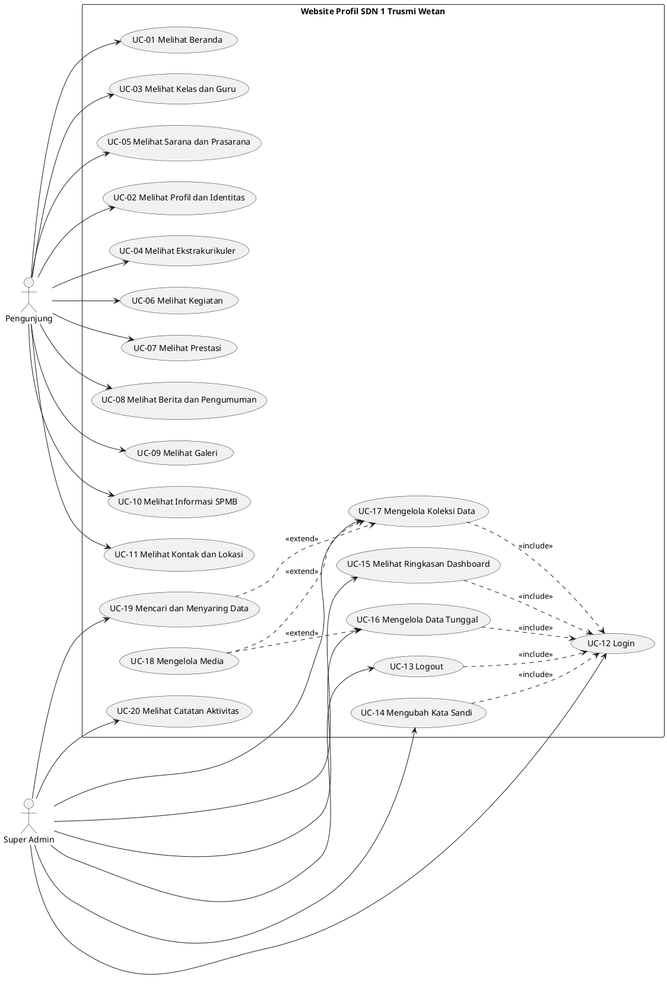
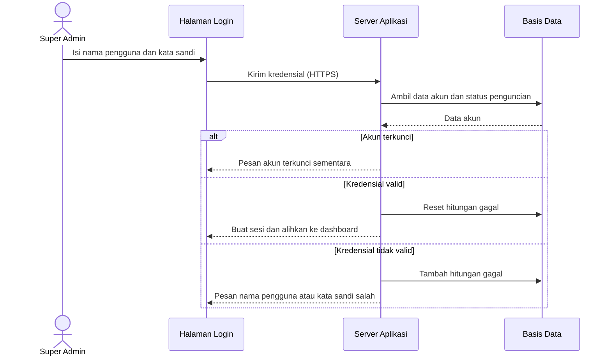
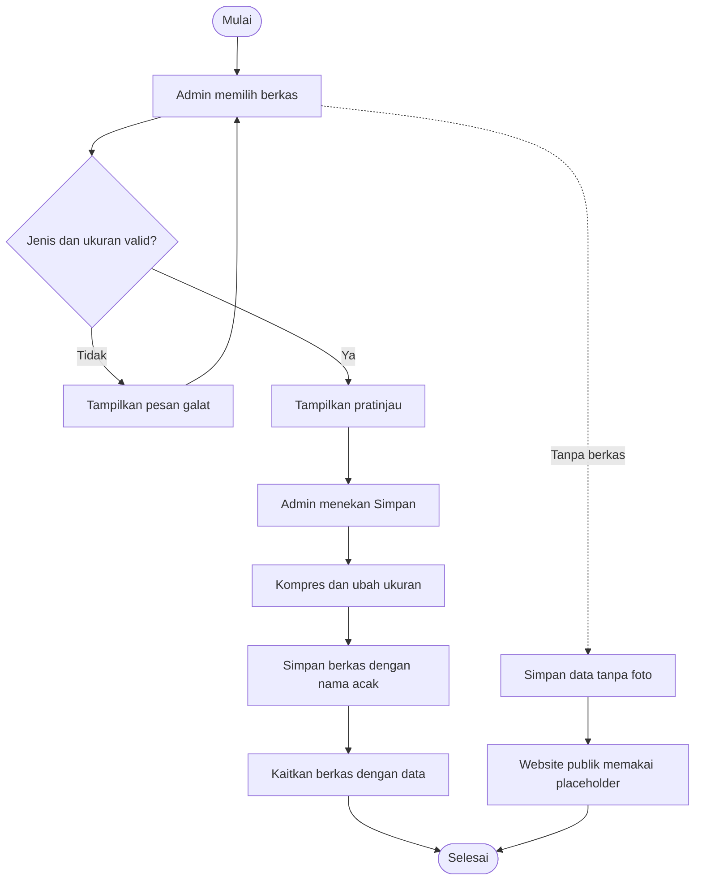
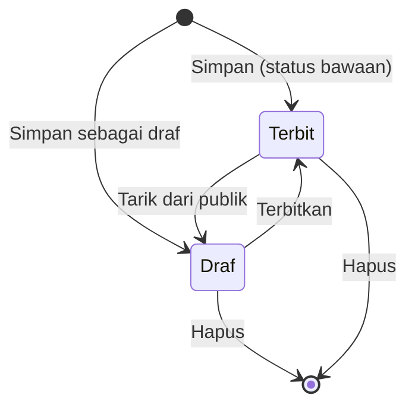

# Software Requirements Specification (SRS)
## Website Informasi dan Profil SDN 1 Trusmi Wetan

| Atribut | Keterangan |
|---|---|
| Nama produk | Sistem Informasi Profil Sekolah Berbasis Web, SDN 1 Trusmi Wetan |
| Jenis proyek | Proyek Capstone |
| Versi dokumen | 1.0 (Draf) |
| Dokumen induk | PRD Website Profil SDN 1 Trusmi Wetan v1.1 |
| Acuan struktur | ISO/IEC/IEEE 29148:2018 (turunan IEEE 830) |
| Notasi pemodelan | UML 2.x (use case, sequence, state) dan ERD (notasi crow's foot) |
| Status | Menunggu verifikasi data, jawaban pertanyaan terbuka, dan persetujuan sekolah |

Catatan: nilai numerik teknis (ukuran berkas, batas waktu, jumlah item per halaman) bertanda **(usulan)** dan dapat disesuaikan pada saat pengembangan.

---

## 1. Pendahuluan

### 1.1 Tujuan Dokumen
Dokumen ini menjabarkan kebutuhan perangkat lunak secara rinci untuk Website Informasi dan Profil SDN 1 Trusmi Wetan. Dokumen menjadi acuan bagi perancang antarmuka, pengembang, penguji, dan pihak sekolah dalam menyepakati perilaku sistem.

### 1.2 Lingkup Produk
Sistem terdiri atas dua bagian:

1. **Website publik**, yang dapat diakses tanpa login dan menampilkan profil, prestasi, kegiatan, fasilitas, informasi SPMB, dan kontak sekolah.
2. **Dashboard admin**, yang hanya dapat diakses oleh **satu super admin** untuk mengelola seluruh data yang tampil di website publik.

Sistem **tidak** mencakup: pendaftaran SPMB daring, pengelolaan berkas pendaftar, data pribadi siswa dan nilai, akun pengunjung, komentar dan forum, peran pengguna selain super admin, aplikasi seluler asli, dan sistem pembayaran (sesuai PRD Bagian 5.2). Formulir pesan pengunjung tidak disertakan (PRD Bagian 13, asumsi 3).

### 1.3 Definisi dan Singkatan

| Istilah | Penjelasan |
|---|---|
| SPMB | Sistem Penerimaan Murid Baru (istilah yang dipakai seragam; PPDB tidak digunakan) |
| PIP / KIP | Program Indonesia Pintar / Kartu Indonesia Pintar |
| NPSN | Nomor Pokok Sekolah Nasional |
| Rombel | Rombongan belajar (kelas, misalnya 1A) |
| Super admin | Satu-satunya pengguna dashboard |
| Pengunjung | Pengguna website publik tanpa login |
| CRUD | Create, Read, Update, Delete (tambah, lihat, ubah, hapus) |
| Data tunggal | Data yang hanya memiliki satu set per sekolah; hanya dapat dilihat dan diubah |
| Koleksi data | Data berjumlah banyak; dapat ditambah, dilihat, diubah, dan dihapus |
| Terbit / Draf | Status konten; hanya konten **terbit** yang tampil di website publik |
| Placeholder | Gambar pengganti bawaan sistem apabila foto tidak diunggah |
| UAT | User Acceptance Test (uji penerimaan pengguna) |
| CSRF / XSS | Cross-Site Request Forgery / Cross-Site Scripting |
| WIB | Waktu Indonesia Barat (zona waktu acuan) |

### 1.4 Referensi
1. PRD Website Informasi dan Profil SDN 1 Trusmi Wetan v1.1.
2. Hasil wawancara dan kuesioner awal dengan pihak SDN 1 Trusmi Wetan.
3. ISO/IEC/IEEE 29148:2018, Systems and software engineering, Requirements engineering.
4. Website referensi tampilan: https://spmb.smkn1-cirebon.sch.id/.

### 1.5 Konvensi Penulisan
- **FR-PUB-xxx**: kebutuhan fungsional website publik. **FR-ADM-xxx**: kebutuhan fungsional dashboard. **NFR-xxx**: kebutuhan non-fungsional. **BR-xx**: aturan bisnis. **UC-xx**: use case.
- Prioritas: **P0** wajib pada rilis pertama, **P1** penting, **P2** opsional/menyusul (selaras dengan PRD).
- Kolom **Ref. PRD** menunjukkan keterlusuran ke PRD.

---

## 2. Deskripsi Umum

### 2.1 Perspektif Produk
Produk berdiri sendiri dan tidak terintegrasi dengan sistem lain (misalnya Dapodik). Tautan eksternal hanya berupa Google Maps, Instagram, TikTok, dan WhatsApp.

```
+------------------+      HTTPS       +----------------------------+     +----------------+
| Pengunjung       | ---------------> |  Website Publik            |     |                |
| (browser)        |                  |  (baca data terbit)        | --> |  Basis Data    |
+------------------+                  +----------------------------+     |  dan           |
                                                                          |  Penyimpanan   |
+------------------+      HTTPS       +----------------------------+     |  Berkas        |
| Super Admin      | ---------------> |  Dashboard Admin           | --> |  (media)       |
| (browser)        |                  |  (CRUD, login)             |     |                |
+------------------+                  +----------------------------+     +----------------+
```

Pemilihan teknologi (bahasa pemrograman, kerangka kerja, basis data) belum ditetapkan dan akan diputuskan pada tahap perancangan. Kebutuhan pada dokumen ini bersifat netral teknologi.

### 2.2 Fungsi Utama Produk
1. Menampilkan informasi profil, akademik, kegiatan, prestasi, galeri, SPMB, dan kontak sekolah.
2. Mengautentikasi super admin.
3. Mengelola data tunggal dan koleksi data melalui dashboard.
4. Mengelola media (foto dan dokumen) dengan kompresi dan placeholder otomatis.
5. Mengatur status terbit/draf dan urutan tampil konten.

### 2.3 Karakteristik Pengguna

| Pengguna | Karakteristik | Implikasi desain |
|---|---|---|
| Pengunjung | Calon wali murid, orang tua, masyarakat; mayoritas memakai ponsel; kemampuan teknis beragam | Tampilan sederhana, cepat, responsif |
| Super admin | Staf sekolah (Pak Niko Rindi Mulyana); bukan berlatar teknis; memakai laptop sekolah (4 unit tersedia) | Dashboard sederhana, label Indonesia, konfirmasi aksi berisiko |

### 2.4 Batasan
1. Hanya satu akun super admin; tidak ada fitur pendaftaran akun.
2. Seluruh antarmuka berbahasa Indonesia.
3. Nomor pribadi kepala sekolah tidak ditampilkan; data pribadi siswa tidak disimpan.
4. Sistem bergantung pada ketersediaan hosting dan domain yang belum dikonfirmasi (PRD pertanyaan terbuka nomor 7).
5. Target rilis tahap 1: Desember 2026 (asumsi PRD).

### 2.5 Asumsi dan Dependensi
1. Kelengkapan data tidak menghambat pengembangan; konten sementara dan placeholder dipakai sampai data asli tersedia (PRD Bagian 11).
2. Akun super admin dibuat awal oleh pengembang (seeding); pemulihan kata sandi dilakukan manual oleh pengembang (PRD asumsi 4).
3. Satu gambar placeholder seragam disediakan pengembang untuk seluruh modul (PRD asumsi 7).
4. Wali kelas pada rombel dipilih dari data guru dan tenaga kependidikan. Karena modul guru dan kelas berada pada tahap yang sama (tahap 2), pada MVP halaman terkait memakai data tetap sementara sampai keputusan PRD pertanyaan terbuka nomor 8 ditetapkan.
5. Pihak sekolah menyediakan data dan dokumentasi, serta bersedia melakukan UAT.

---

## 3. Kebutuhan Antarmuka Eksternal

### 3.1 Antarmuka Pengguna

**Struktur halaman dan rute (usulan)**

| Area | Rute | Halaman |
|---|---|---|
| Publik | `/` | Beranda |
| Publik | `/profil` | Profil sekolah (sambutan, visi, misi, tujuan, sejarah) |
| Publik | `/identitas` | Identitas dan akreditasi |
| Publik | `/kelas-guru` | Kelas dan guru |
| Publik | `/ekstrakurikuler` | Ekstrakurikuler |
| Publik | `/sarana-prasarana` | Sarana dan prasarana |
| Publik | `/kegiatan`, `/kegiatan/{slug}` | Daftar dan detail kegiatan |
| Publik | `/prestasi`, `/prestasi/{id}` | Daftar dan detail prestasi |
| Publik | `/berita`, `/berita/{slug}` | Daftar dan detail berita dan pengumuman |
| Publik | `/galeri` | Galeri |
| Publik | `/spmb` | Informasi SPMB |
| Publik | `/hubungi-kami` | Hubungi Kami |
| Admin | `/admin/login` | Login |
| Admin | `/admin` | Ringkasan dashboard |
| Admin | `/admin/{modul}` | Daftar, tambah, ubah data per modul |
| Admin | `/admin/kata-sandi` | Ubah kata sandi |

**Kebutuhan umum antarmuka**

| ID | Kebutuhan | Prioritas |
|---|---|---|
| UI-01 | Header berisi logo/nama sekolah dan menu utama; pada layar kecil menu berubah menjadi menu ringkas (hamburger) | P0 |
| UI-02 | Dashboard memiliki menu samping (sidebar) berisi seluruh modul, dengan penanda modul aktif | P0 |
| UI-03 | Setiap formulir menampilkan penanda kolom wajib, pesan galat di dekat kolom, dan tombol Simpan serta Batal | P0 |
| UI-04 | Setiap aksi hapus menampilkan dialog konfirmasi dengan nama data yang akan dihapus | P0 |
| UI-05 | Setelah aksi berhasil atau gagal, sistem menampilkan pesan notifikasi (Lampiran A) | P0 |
| UI-06 | Tampilan mengikuti gaya referensi (SPMB SMKN 1 Cirebon) sebagai inspirasi tata letak, bukan salinan | P1 |

### 3.2 Antarmuka Perangkat Keras
Tidak ada antarmuka perangkat keras khusus. Pengguna memakai ponsel, tablet, laptop, atau komputer dengan peramban modern.

### 3.3 Antarmuka Perangkat Lunak
Peramban modern (Chrome, Edge, Firefox, Safari: dua versi mayor terakhir). Layanan eksternal: Google Maps (tautan atau tampilan tertanam), tautan sosial media.

### 3.4 Antarmuka Komunikasi
Seluruh komunikasi memakai HTTPS. Tidak ada antarmuka pesan, surel, atau notifikasi eksternal.

---

## 4. Kebutuhan Fungsional

### 4.1 Website Publik

#### 4.1.1 Kebutuhan Umum

| ID | Kebutuhan | Prioritas | Ref. PRD |
|---|---|---|---|
| FR-PUB-001 | Sistem menampilkan menu navigasi utama pada seluruh halaman publik: Beranda, Profil, Akademik (Kelas dan Guru, Ekstrakurikuler, Sarana dan Prasarana), Kegiatan, Prestasi, Berita, Galeri, SPMB, Hubungi Kami | P0 | PUB-01 s.d. PUB-15 |
| FR-PUB-002 | Sistem menampilkan footer global berisi identitas singkat sekolah, tautan navigasi, dan tautan media sosial yang telah diisi admin | P0 | PUB-15 |
| FR-PUB-003 | Sistem hanya menampilkan data berstatus **terbit** | P0 | BR-04 |
| FR-PUB-004 | Apabila foto suatu data tidak tersedia, sistem menampilkan gambar placeholder bawaan | P0 | BR-09 |
| FR-PUB-005 | Apabila kolom opsional kosong, sistem menyembunyikan kolom tersebut atau menampilkan "Informasi belum tersedia" tanpa menimbulkan galat | P0 | BR-10 |
| FR-PUB-006 | Apabila suatu daftar tidak memiliki data terbit, sistem menampilkan pesan "Belum ada data" pada halaman tersebut | P0 | BR-10 |
| FR-PUB-007 | Sistem menampilkan halaman "Halaman tidak ditemukan" untuk rute tidak valid atau data tidak terbit | P0 | - |
| FR-PUB-008 | Sistem menampilkan tanggal dalam format Indonesia (misalnya 16 November 2026) dengan zona waktu WIB | P1 | - |
| FR-PUB-009 | Daftar berita, kegiatan, prestasi, dan galeri memakai penomoran halaman: berita 9, kegiatan 9, prestasi 12, galeri 12 item per halaman (usulan) | P1 | PUB-08 s.d. PUB-11 |
| FR-PUB-010 | Setiap halaman memiliki judul halaman dan deskripsi meta; halaman detail memakai judul dan ringkasan data terkait | P1 | NFR SEO |
| FR-PUB-011 | Seluruh gambar memiliki teks alternatif (judul data atau keterangan) | P1 | NFR Kegunaan |

#### 4.1.2 Beranda (PUB-01)

| ID | Kebutuhan | Prioritas |
|---|---|---|
| FR-PUB-012 | Menampilkan banner (judul, subjudul, gambar) dari pengaturan Beranda; apabila gambar kosong dipakai placeholder | P0 |
| FR-PUB-013 | Menampilkan ringkasan profil (teks pembuka) dengan tautan ke halaman Profil | P0 |
| FR-PUB-014 | Menampilkan statistik ringkas (jumlah siswa, guru, rombel, prestasi) hanya untuk angka yang telah diisi admin | P1 |
| FR-PUB-015 | Menampilkan sorotan prestasi: 4 prestasi terbit terbaru (urut tahun terbaru) dengan tautan "Lihat semua" | P0 |
| FR-PUB-016 | Menampilkan 3 berita atau pengumuman terbit terbaru dengan tautan "Lihat semua" | P0 |
| FR-PUB-017 | Menampilkan kegiatan rutin (kegiatan terbit yang ditandai rutin), maksimal 6 item | P0 |

#### 4.1.3 Profil dan Identitas (PUB-02, PUB-03)

| ID | Kebutuhan | Prioritas |
|---|---|---|
| FR-PUB-018 | Halaman Profil menampilkan sambutan kepala sekolah (nama, teks, foto) | P0 |
| FR-PUB-019 | Halaman Profil menampilkan visi, daftar misi terbit (urut sesuai urutan), dan tujuan | P0 |
| FR-PUB-020 | Halaman Profil menampilkan sejarah singkat (teks dan foto pendukung) | P0 |
| FR-PUB-021 | Halaman Identitas menampilkan nama sekolah, NPSN, status sekolah, akreditasi, dan alamat lengkap | P0 |

#### 4.1.4 Akademik dan Kesiswaan (PUB-05, PUB-06, PUB-07)

| ID | Kebutuhan | Prioritas |
|---|---|---|
| FR-PUB-022 | Halaman Kelas dan Guru menampilkan daftar rombel terbit: nama rombel, wali kelas, dan jumlah siswa | P0 |
| FR-PUB-023 | Halaman Kelas dan Guru menampilkan total siswa yang dihitung dari penjumlahan jumlah siswa seluruh rombel yang terisi | P1 |
| FR-PUB-024 | Halaman Kelas dan Guru menampilkan daftar guru dan tenaga kependidikan terbit: foto, nama, jabatan, dan mata pelajaran | P0 |
| FR-PUB-025 | Halaman Ekstrakurikuler menampilkan daftar terbit: nama, deskripsi, pembina, jadwal, dan foto | P0 |
| FR-PUB-026 | Halaman Sarana dan Prasarana menampilkan daftar fasilitas terbit: nama, deskripsi, jumlah, dan foto; kolom kondisi hanya tampil apabila diisi | P0 |

#### 4.1.5 Kegiatan, Prestasi, Berita, Galeri (PUB-08 s.d. PUB-11)

| ID | Kebutuhan | Prioritas |
|---|---|---|
| FR-PUB-027 | Halaman daftar Kegiatan menampilkan kartu kegiatan terbit, urut tanggal terbaru, dengan filter "Kegiatan rutin" | P0 |
| FR-PUB-028 | Halaman detail Kegiatan menampilkan judul, tanggal, foto, dan deskripsi lengkap | P0 |
| FR-PUB-029 | Halaman daftar Prestasi menampilkan kartu prestasi terbit: nama, peraih, tingkat, tahun, foto; urut tahun terbaru | P0 |
| FR-PUB-030 | Halaman detail Prestasi menampilkan seluruh kolom prestasi yang terisi | P0 |
| FR-PUB-031 | Halaman daftar Berita menampilkan berita terbit: judul, tanggal, foto, dan kutipan isi (maksimal 150 karakter); urut tanggal terbaru | P0 |
| FR-PUB-032 | Halaman detail Berita menampilkan judul, tanggal, foto, dan isi lengkap | P0 |
| FR-PUB-033 | Halaman Galeri menampilkan foto terbit dalam kisi, dikelompokkan atau difilter menurut album; foto dapat diperbesar | P1 |

#### 4.1.6 Informasi SPMB (PUB-13)

| ID | Kebutuhan | Prioritas |
|---|---|---|
| FR-PUB-034 | Menampilkan status pendaftaran (Dibuka atau Ditutup) dan teks pengantar | P0 |
| FR-PUB-035 | Menampilkan daftar persyaratan terbit sesuai urutan (misalnya akta kelahiran, KK, KTP orang tua, PIP/KIP) | P0 |
| FR-PUB-036 | Menampilkan jadwal dan tahapan dalam dua kelompok: **Pendaftaran** dan **Daftar Ulang**, masing-masing dengan tanggal mulai, tanggal selesai (bila ada), dan keterangan | P0 |
| FR-PUB-037 | Menampilkan pamflet SPMB terbit (lihat dan unduh) beserta judul dan tahun | P0 |
| FR-PUB-038 | Menampilkan informasi PIP/KIP dari pengaturan SPMB | P1 |
| FR-PUB-039 | Halaman SPMB tidak menyediakan formulir pendaftaran; hanya informasi | P0 |

#### 4.1.7 Hubungi Kami (PUB-14)

| ID | Kebutuhan | Prioritas |
|---|---|---|
| FR-PUB-040 | Menampilkan alamat lengkap dan jam operasional per hari; hari bertanda libur ditampilkan "Libur" | P0 |
| FR-PUB-041 | Menampilkan peta lokasi melalui tautan atau tampilan tertanam Google Maps dari URL yang diisi admin | P0 |
| FR-PUB-042 | Menampilkan kontak publik (telepon, surel, WhatsApp) yang diisi admin, serta tautan Instagram dan TikTok | P0 |
| FR-PUB-043 | Halaman tidak menyediakan formulir pesan | P0 |

### 4.2 Dashboard Super Admin

#### 4.2.1 Autentikasi dan Akun

| ID | Kebutuhan | Prioritas | Ref. PRD |
|---|---|---|---|
| FR-ADM-001 | Sistem menyediakan halaman login berisi nama pengguna dan kata sandi | P0 | ADM-01 |
| FR-ADM-002 | Sistem memvalidasi kredensial; apabila salah, sistem menampilkan pesan umum "Nama pengguna atau kata sandi salah" tanpa menyebutkan kolom mana yang salah | P0 | ADM-01 |
| FR-ADM-003 | Setelah 5 kali gagal berturut-turut, sistem mengunci login selama 15 menit (usulan) | P0 | NFR Keamanan |
| FR-ADM-004 | Sistem mengakhiri sesi otomatis setelah 30 menit tanpa aktivitas (usulan) dan mengarahkan ke halaman login | P1 | NFR Keamanan |
| FR-ADM-005 | Sistem menyediakan fitur logout yang mengakhiri sesi | P0 | ADM-01 |
| FR-ADM-006 | Seluruh rute `/admin/*` selain login hanya dapat diakses setelah login; akses tanpa login dialihkan ke halaman login | P0 | BR-03 |
| FR-ADM-007 | Super admin dapat mengubah kata sandi dengan mengisi kata sandi lama, kata sandi baru, dan konfirmasi | P0 | ADM-02 |
| FR-ADM-008 | Kata sandi baru minimal 8 karakter, memuat huruf dan angka, serta berbeda dari kata sandi lama | P0 | ADM-02 |
| FR-ADM-009 | Sistem tidak menyediakan fitur registrasi akun maupun lupa kata sandi otomatis | P0 | BR-01 |

#### 4.2.2 Ringkasan Dashboard

| ID | Kebutuhan | Prioritas | Ref. PRD |
|---|---|---|---|
| FR-ADM-010 | Dashboard menampilkan jumlah berita, prestasi, kegiatan, dan foto galeri (terbit dan draf) | P1 | ADM-03 |
| FR-ADM-011 | Dashboard menyediakan pintasan ke tambah berita, tambah prestasi, tambah kegiatan, dan modul SPMB | P1 | ADM-03 |

#### 4.2.3 Pengelolaan Data Tunggal

| ID | Kebutuhan | Prioritas | Ref. PRD |
|---|---|---|---|
| FR-ADM-012 | Untuk setiap data tunggal (Bagian 6.2) sistem menyediakan satu formulir ubah yang terisi nilai saat ini | P0 | ADM-04 |
| FR-ADM-013 | Data tunggal tidak dapat ditambah atau dihapus; hanya dilihat dan diubah | P0 | PRD 8.1 |
| FR-ADM-014 | Satu-satunya kolom wajib pada seluruh data tunggal adalah **nama sekolah** (Identitas sekolah); kolom lain opsional | P0 | PRD 8.3 |
| FR-ADM-015 | Pengaturan SPMB memuat status pendaftaran (Dibuka atau Ditutup, bawaan Ditutup), teks pengantar, dan informasi PIP/KIP | P0 | PRD 8.1 |
| FR-ADM-016 | Jam operasional dikelola per hari (Senin s.d. Minggu) dengan jam buka, jam tutup, dan penanda libur; jam tutup harus setelah jam buka | P0 | PRD 8.1 |
| FR-ADM-017 | Pada kolom kontak, sistem menampilkan pengingat bahwa nomor pribadi kepala sekolah tidak boleh dicantumkan | P1 | BR-05 |

#### 4.2.4 Pengelolaan Koleksi Data (CRUD)

Ketentuan berikut berlaku untuk seluruh modul pada Bagian 6.3 kecuali dinyatakan lain.

| ID | Kebutuhan | Prioritas | Ref. PRD |
|---|---|---|---|
| FR-ADM-018 | **Lihat daftar:** sistem menampilkan data dalam tabel dengan kolom ringkas, status, dan tombol aksi (Ubah, Hapus); urutan bawaan data terbaru; penomoran halaman 10 item (usulan) | P0 | ADM-04 |
| FR-ADM-019 | **Tambah:** sistem menyediakan formulir sesuai kolom modul; hanya kolom wajib yang harus diisi | P0 | ADM-04, BR-08 |
| FR-ADM-020 | **Ubah:** sistem menyediakan formulir terisi nilai saat ini; perubahan tersimpan setelah validasi lolos | P0 | ADM-04 |
| FR-ADM-021 | **Hapus:** sistem menampilkan dialog konfirmasi; setelah dikonfirmasi data dihapus permanen dari daftar dan dari website publik | P0 | ADM-08 |
| FR-ADM-022 | Penghapusan data yang memiliki foto menghapus relasi foto; berkas dihapus dari penyimpanan apabila tidak dipakai data lain | P1 | ADM-05 |
| FR-ADM-023 | **Status:** setiap data koleksi memiliki status Draf atau Terbit; nilai bawaan **Terbit** (usulan); admin dapat mengubah status dari formulir maupun daftar | P1 | ADM-06 |
| FR-ADM-024 | **Urutan:** modul Misi, Persyaratan SPMB, dan Ekstrakurikuler menyediakan pengaturan urutan tampil (kolom angka atau tombol naik/turun); apabila kosong, data dikembalikan menurut waktu input | P1 | ADM-07 |
| FR-ADM-025 | Jadwal SPMB: tanggal selesai (bila diisi) tidak boleh sebelum tanggal mulai; tahap hanya bernilai Pendaftaran atau Daftar Ulang | P0 | PRD 8.2 |
| FR-ADM-026 | Berita: sistem membuat alamat (slug) otomatis dari judul dan menjamin keunikan; tanggal bawaan adalah tanggal hari ini | P0 | PRD 8.2 |
| FR-ADM-027 | Kegiatan: admin dapat menandai kegiatan sebagai **rutin** (misalnya salat Duha berjamaah, senam Sabtu, les tambahan) | P0 | PRD 8.2 |
| FR-ADM-028 | Galeri: admin dapat membuat album, mengunggah beberapa foto sekaligus, dan memindahkan foto antar album; foto wajib ada pada setiap item galeri | P1 | PRD 8.2 |
| FR-ADM-029 | Kelas/rombel: wali kelas dipilih dari daftar guru dan tenaga kependidikan (opsional) | P1 | PRD 8.2 |
| FR-ADM-030 | Pamflet/dokumen: berkas wajib diunggah dan tampil di halaman SPMB | P0 | PRD 8.2 |
| FR-ADM-031 | Sistem memberi nama baku "Terbit" atau "Draf" pada daftar dan menyediakan pencarian judul serta filter status (P2) | P2 | ADM-09 |
| FR-ADM-032 | Isi teks panjang (isi berita, deskripsi, sambutan, sejarah) disediakan editor teks sederhana: paragraf, huruf tebal, miring, dan daftar; masukan dibersihkan dari skrip berbahaya sebelum disimpan | P0 | NFR Keamanan |

#### 4.2.5 Pengelolaan Media

| ID | Kebutuhan | Prioritas | Ref. PRD |
|---|---|---|---|
| FR-ADM-033 | Unggah foto bersifat **opsional** pada seluruh modul kecuali Galeri (foto wajib) dan Pamflet (berkas wajib) | P0 | ADM-05, BR-09 |
| FR-ADM-034 | Format foto yang diterima: JPG, JPEG, PNG, WEBP; ukuran maksimal 5 MB per foto sebelum kompresi (usulan) | P0 | ADM-05 |
| FR-ADM-035 | Format pamflet yang diterima: PDF, JPG, PNG; ukuran maksimal 10 MB (usulan) | P0 | ADM-05 |
| FR-ADM-036 | Sistem mengompresi dan mengubah ukuran foto secara otomatis (sisi terpanjang maksimal 1600 piksel, kualitas sekitar 80 persen; usulan) | P0 | NFR Kinerja |
| FR-ADM-037 | Sistem menampilkan pratinjau foto setelah dipilih dan sebelum disimpan | P1 | - |
| FR-ADM-038 | Admin dapat mengganti foto (foto lama dilepas) dan menghapus foto; setelah dihapus, website publik kembali menampilkan placeholder | P0 | ADM-05, BR-09 |
| FR-ADM-039 | Sistem menolak berkas dengan format atau ukuran tidak sesuai dan menampilkan pesan yang jelas; isi berkas diperiksa, bukan hanya ekstensi | P0 | NFR Keamanan |
| FR-ADM-040 | Nama berkas di penyimpanan dibuat acak oleh sistem untuk mencegah tabrakan dan eksekusi berkas berbahaya | P0 | NFR Keamanan |

#### 4.2.6 Catatan Aktivitas (P2)

| ID | Kebutuhan | Prioritas | Ref. PRD |
|---|---|---|---|
| FR-ADM-041 | Sistem mencatat aksi tambah, ubah, dan hapus: waktu, jenis aksi, modul, dan ringkasan data | P2 | ADM-10 |
| FR-ADM-042 | Super admin dapat melihat catatan aktivitas dalam daftar yang dapat difilter menurut modul dan tanggal | P2 | ADM-10 |

---

## 5. Pemodelan Use Case

### 5.1 Aktor

| Aktor | Deskripsi |
|---|---|
| Pengunjung | Pengguna website publik tanpa login |
| Super Admin | Pengguna dashboard; satu akun |

### 5.2 Daftar Use Case

| ID | Nama | Aktor | Prioritas | Kebutuhan terkait |
|---|---|---|---|---|
| UC-01 | Melihat Beranda | Pengunjung | P0 | FR-PUB-012 s.d. 017 |
| UC-02 | Melihat Profil dan Identitas Sekolah | Pengunjung | P0 | FR-PUB-018 s.d. 021 |
| UC-03 | Melihat Kelas dan Guru | Pengunjung | P0 | FR-PUB-022 s.d. 024 |
| UC-04 | Melihat Ekstrakurikuler | Pengunjung | P0 | FR-PUB-025 |
| UC-05 | Melihat Sarana dan Prasarana | Pengunjung | P0 | FR-PUB-026 |
| UC-06 | Melihat Kegiatan | Pengunjung | P0 | FR-PUB-027, 028 |
| UC-07 | Melihat Prestasi | Pengunjung | P0 | FR-PUB-029, 030 |
| UC-08 | Melihat Berita dan Pengumuman | Pengunjung | P0 | FR-PUB-031, 032 |
| UC-09 | Melihat Galeri | Pengunjung | P1 | FR-PUB-033 |
| UC-10 | Melihat Informasi SPMB | Pengunjung | P0 | FR-PUB-034 s.d. 039 |
| UC-11 | Melihat Kontak dan Lokasi | Pengunjung | P0 | FR-PUB-040 s.d. 043 |
| UC-12 | Login | Super Admin | P0 | FR-ADM-001 s.d. 003, 006 |
| UC-13 | Logout | Super Admin | P0 | FR-ADM-005 |
| UC-14 | Mengubah Kata Sandi | Super Admin | P0 | FR-ADM-007, 008 |
| UC-15 | Melihat Ringkasan Dashboard | Super Admin | P1 | FR-ADM-010, 011 |
| UC-16 | Mengelola Data Tunggal | Super Admin | P0 | FR-ADM-012 s.d. 017 |
| UC-17 | Mengelola Koleksi Data | Super Admin | P0 | FR-ADM-018 s.d. 032 |
| UC-18 | Mengelola Media | Super Admin | P0 | FR-ADM-033 s.d. 040 |
| UC-19 | Mencari dan Menyaring Data | Super Admin | P2 | FR-ADM-031 |
| UC-20 | Melihat Catatan Aktivitas | Super Admin | P2 | FR-ADM-041, 042 |

### 5.3 Diagram Use Case (PlantUML)



### 5.4 Spesifikasi Use Case

#### UC-10 Melihat Informasi SPMB

| Elemen | Uraian |
|---|---|
| Aktor | Pengunjung |
| Tujuan | Mengetahui status, persyaratan, jadwal, dan pamflet SPMB |
| Prasyarat | Pengunjung membuka website |
| Pascakondisi | Informasi SPMB terbaca |
| Alur utama | 1. Pengunjung memilih menu SPMB. 2. Sistem menampilkan status pendaftaran dan teks pengantar. 3. Sistem menampilkan persyaratan terbit sesuai urutan. 4. Sistem menampilkan jadwal Pendaftaran dan Daftar Ulang. 5. Sistem menampilkan pamflet dan informasi PIP/KIP. 6. Pengunjung dapat mengunduh pamflet. |
| Alur alternatif | 2a. Pengaturan SPMB belum diisi: sistem menampilkan "Informasi belum tersedia". 3a/4a/5a. Bagian tidak memiliki data terbit: sistem menampilkan "Belum ada data" pada bagian tersebut. |
| Aturan bisnis | BR-04, BR-07, BR-10 |

#### UC-12 Login

| Elemen | Uraian |
|---|---|
| Aktor | Super Admin |
| Tujuan | Masuk ke dashboard |
| Prasyarat | Akun super admin telah dibuat oleh pengembang |
| Pascakondisi | Sesi admin aktif; admin diarahkan ke ringkasan dashboard |
| Alur utama | 1. Admin membuka `/admin/login`. 2. Admin mengisi nama pengguna dan kata sandi. 3. Sistem memvalidasi masukan tidak kosong. 4. Sistem memverifikasi kredensial. 5. Sistem membuat sesi dan mengalihkan ke dashboard. |
| Alur alternatif | 3a. Kolom kosong: sistem menampilkan pesan validasi. 4a. Kredensial salah: sistem menampilkan pesan umum dan menambah hitungan gagal. 4b. Gagal mencapai 5 kali: sistem mengunci login 15 menit dan menampilkan pesan penguncian. |
| Aturan bisnis | BR-01, BR-03 |

#### UC-14 Mengubah Kata Sandi

| Elemen | Uraian |
|---|---|
| Aktor | Super Admin |
| Prasyarat | Admin sudah login |
| Pascakondisi | Kata sandi diperbarui (tersimpan terenkripsi) |
| Alur utama | 1. Admin membuka menu Ubah Kata Sandi. 2. Admin mengisi kata sandi lama, baru, dan konfirmasi. 3. Sistem memvalidasi aturan kata sandi (FR-ADM-008). 4. Sistem memverifikasi kata sandi lama. 5. Sistem menyimpan kata sandi baru dan menampilkan notifikasi sukses. |
| Alur alternatif | 3a. Aturan tidak terpenuhi: sistem menampilkan pesan galat. 4a. Kata sandi lama salah: sistem menolak perubahan. |

#### UC-16 Mengelola Data Tunggal

| Elemen | Uraian |
|---|---|
| Aktor | Super Admin |
| Prasyarat | Admin sudah login |
| Pascakondisi | Data tunggal diperbarui dan tampil di website publik |
| Alur utama | 1. Admin memilih modul data tunggal (misalnya Identitas sekolah). 2. Sistem menampilkan formulir terisi nilai saat ini. 3. Admin mengubah kolom yang diperlukan. 4. Admin menekan Simpan. 5. Sistem memvalidasi dan menyimpan. 6. Sistem menampilkan notifikasi sukses. |
| Alur alternatif | 5a. Validasi gagal (misalnya nama sekolah kosong, jam tutup sebelum jam buka): sistem menampilkan pesan galat dan data tidak berubah. |
| Aturan bisnis | BR-08, BR-10 |

#### UC-17 Mengelola Koleksi Data

| Elemen | Uraian |
|---|---|
| Aktor | Super Admin |
| Prasyarat | Admin sudah login |
| Pascakondisi | Data koleksi bertambah, berubah, atau terhapus |
| Alur utama (tambah) | 1. Admin membuka modul koleksi (misalnya Berita). 2. Sistem menampilkan daftar data. 3. Admin menekan Tambah. 4. Sistem menampilkan formulir kosong. 5. Admin mengisi kolom wajib dan, bila ada, kolom opsional serta foto. 6. Admin memilih status (Draf atau Terbit) dan menekan Simpan. 7. Sistem memvalidasi dan menyimpan. 8. Sistem menampilkan notifikasi sukses dan kembali ke daftar. |
| Alur utama (ubah) | Admin menekan Ubah pada suatu baris, sistem menampilkan formulir terisi, admin mengubah dan menyimpan; langkah validasi sama dengan tambah. |
| Alur utama (hapus) | Admin menekan Hapus; sistem menampilkan dialog konfirmasi; setelah admin mengonfirmasi, sistem menghapus data dan notifikasi sukses tampil. |
| Alur alternatif | 7a. Kolom wajib kosong atau tidak valid: sistem menandai kolom dan data tidak disimpan. 6a. Admin menekan Batal: tidak ada perubahan. Hapus-a. Admin membatalkan dialog: data tetap ada. |
| Aturan bisnis | BR-04, BR-08, BR-09 |

#### UC-18 Mengelola Media

| Elemen | Uraian |
|---|---|
| Aktor | Super Admin |
| Prasyarat | Admin berada pada formulir yang memiliki kolom foto atau berkas |
| Pascakondisi | Foto tersimpan terkompresi dan terkait dengan data; atau relasi dilepas |
| Alur utama | 1. Admin memilih berkas dari perangkat. 2. Sistem memeriksa jenis dan ukuran. 3. Sistem menampilkan pratinjau. 4. Admin menyimpan formulir. 5. Sistem mengompresi dan menyimpan berkas, lalu mengaitkannya dengan data. |
| Alur alternatif | 2a. Jenis atau ukuran tidak sesuai: sistem menolak dengan pesan galat. 1a. Admin tidak memilih berkas: data tersimpan tanpa foto dan website publik memakai placeholder. 5a. Admin menghapus foto: relasi dilepas dan placeholder tampil kembali. |
| Aturan bisnis | BR-09 |

### 5.5 Diagram Sequence: Login



### 5.6 Diagram Alur: Unggah Foto



### 5.7 Diagram State: Status Konten



---

## 6. Model Data

### 6.1 Diagram ERD

```mermaid
erDiagram
    USERS {
        int id PK
        string username
        string password_hash
    }
    MEDIA {
        int id PK
        string file_path
        string mime_type
    }
    SCHOOL_IDENTITY {
        int id PK
        string nama_sekolah
    }
    OPERATING_HOURS {
        int id PK
        string hari
    }
    SCHOOL_PROFILE {
        int id PK
        string nama_kepala_sekolah
    }
    SITE_SETTINGS {
        int id PK
        string hero_title
    }
    CONTACT_INFO {
        int id PK
        string whatsapp
    }
    SPMB_SETTINGS {
        int id PK
        string status_pendaftaran
    }
    SPMB_REQUIREMENTS {
        int id PK
        string nama_dokumen
    }
    SPMB_SCHEDULES {
        int id PK
        string tahap
    }
    BROCHURES {
        int id PK
        string judul
    }
    MISSIONS {
        int id PK
        string poin_misi
    }
    NEWS {
        int id PK
        string judul
    }
    ACHIEVEMENTS {
        int id PK
        string nama_prestasi
    }
    ACTIVITIES {
        int id PK
        string judul
    }
    GALLERY_ALBUMS {
        int id PK
        string nama_album
    }
    GALLERY_ITEMS {
        int id PK
        int media_id FK
    }
    EXTRACURRICULARS {
        int id PK
        string nama
    }
    FACILITIES {
        int id PK
        string nama
    }
    STAFF {
        int id PK
        string nama
    }
    CLASSES {
        int id PK
        string nama_rombel
    }
    AUDIT_LOGS {
        int id PK
        string aksi
    }

    MEDIA |o--o{ NEWS : "foto"
    MEDIA |o--o{ ACHIEVEMENTS : "foto"
    MEDIA |o--o{ ACTIVITIES : "foto"
    MEDIA |o--o{ EXTRACURRICULARS : "foto"
    MEDIA |o--o{ FACILITIES : "foto"
    MEDIA |o--o{ STAFF : "foto"
    MEDIA ||--o{ GALLERY_ITEMS : "foto"
    MEDIA ||--o{ BROCHURES : "berkas"
    MEDIA |o--o| SCHOOL_PROFILE : "foto kepala sekolah dan sejarah"
    MEDIA |o--o| SITE_SETTINGS : "banner"
    GALLERY_ALBUMS |o--o{ GALLERY_ITEMS : "berisi"
    STAFF |o--o{ CLASSES : "wali kelas"
    USERS ||--o{ AUDIT_LOGS : "melakukan"
```



Catatan: tabel data tunggal (`SCHOOL_IDENTITY`, `OPERATING_HOURS`, `SCHOOL_PROFILE`, `SITE_SETTINGS`, `CONTACT_INFO`, `SPMB_SETTINGS`) tidak memiliki relasi antar tabel kecuali dengan `MEDIA`.

### 6.2 Kamus Data: Data Tunggal

Setiap tabel memiliki kolom `id`, `created_at`, dan `updated_at`. Tabel data tunggal hanya berisi satu baris, kecuali `OPERATING_HOURS` (satu baris per hari).

**SCHOOL_IDENTITY**

| Kolom | Tipe | Wajib | Keterangan |
|---|---|---|---|
| nama_sekolah | varchar(150) | Ya | Bawaan: SDN 1 Trusmi Wetan |
| npsn | varchar(8) | Tidak | Delapan digit angka |
| status_sekolah | varchar(50) | Tidak | Misalnya Negeri |
| akreditasi | varchar(20) | Tidak | Misalnya A, B, C |
| alamat | text | Tidak | Alamat lengkap |
| maps_url | varchar(500) | Tidak | URL Google Maps (harus diawali https) |

**OPERATING_HOURS**

| Kolom | Tipe | Wajib | Keterangan |
|---|---|---|---|
| hari | enum | Ya | Senin s.d. Minggu; unik |
| jam_buka | time | Tidak | Contoh data awal: 07.00 |
| jam_tutup | time | Tidak | Contoh data awal: 12.10 (Jumat 11.00); lebih besar dari jam_buka |
| is_libur | boolean | Ya | Bawaan false |

**SCHOOL_PROFILE**

| Kolom | Tipe | Wajib | Keterangan |
|---|---|---|---|
| nama_kepala_sekolah | varchar(100) | Tidak | Contoh data awal: Hj. Marpuah, S.Pd. |
| sambutan | text | Tidak | Teks sambutan |
| foto_kepsek_media_id | int (FK MEDIA) | Tidak | Opsional |
| sejarah | text | Tidak | Sejarah singkat |
| sejarah_media_id | int (FK MEDIA) | Tidak | Opsional |
| visi | text | Tidak | |
| tujuan | text | Tidak | |

**SITE_SETTINGS (Beranda)**

| Kolom | Tipe | Wajib | Keterangan |
|---|---|---|---|
| hero_title | varchar(150) | Tidak | Judul banner |
| hero_subtitle | varchar(250) | Tidak | Subjudul banner |
| hero_media_id | int (FK MEDIA) | Tidak | Gambar banner |
| intro_text | text | Tidak | Teks pembuka/ringkasan profil |
| stat_siswa | int | Tidak | Statistik ringkas manual |
| stat_guru | int | Tidak | |
| stat_rombel | int | Tidak | |
| stat_prestasi | int | Tidak | |

**CONTACT_INFO**

| Kolom | Tipe | Wajib | Keterangan |
|---|---|---|---|
| telepon_publik | varchar(20) | Tidak | Bukan nomor pribadi kepala sekolah |
| email_publik | varchar(100) | Tidak | Format surel valid |
| whatsapp | varchar(20) | Tidak | Format angka, diawali kode negara |
| instagram_url | varchar(300) | Tidak | URL https |
| tiktok_url | varchar(300) | Tidak | URL https |

**SPMB_SETTINGS**

| Kolom | Tipe | Wajib | Keterangan |
|---|---|---|---|
| status_pendaftaran | enum | Ya | dibuka atau ditutup; bawaan ditutup |
| teks_pengantar | text | Tidak | |
| info_pip_kip | text | Tidak | |

### 6.3 Kamus Data: Koleksi Data

Seluruh tabel koleksi memiliki kolom `id`, `created_at`, `updated_at`, dan **`status`** (enum `draf`/`terbit`, bawaan `terbit`). Seluruh kolom `media_id` bersifat nullable kecuali dinyatakan lain; apabila kosong, antarmuka publik memakai placeholder.

**NEWS** (Berita dan pengumuman)

| Kolom | Tipe | Wajib | Keterangan |
|---|---|---|---|
| judul | varchar(150) | Ya | |
| slug | varchar(180) | Otomatis | Unik, dibuat dari judul |
| isi | text | Ya | Teks kaya (disanitasi) |
| tanggal | date | Ya | Bawaan hari ini |
| media_id | int | Tidak | Foto |

**ACHIEVEMENTS** (Prestasi)

| Kolom | Tipe | Wajib | Keterangan |
|---|---|---|---|
| nama_prestasi | varchar(150) | Ya | |
| peraih | varchar(150) | Tidak | Siswa atau sekolah |
| tingkat | varchar(50) | Tidak | Misalnya Sekolah, Kecamatan, Kabupaten, Provinsi, Nasional |
| tahun | smallint | Tidak | Empat digit |
| media_id | int | Tidak | Foto |

**ACTIVITIES** (Kegiatan)

| Kolom | Tipe | Wajib | Keterangan |
|---|---|---|---|
| judul | varchar(150) | Ya | |
| slug | varchar(180) | Otomatis | Unik |
| deskripsi | text | Tidak | |
| tanggal | date | Tidak | |
| is_rutin | boolean | Ya | Bawaan false |
| media_id | int | Tidak | Foto |

**GALLERY_ALBUMS**

| Kolom | Tipe | Wajib | Keterangan |
|---|---|---|---|
| nama_album | varchar(100) | Ya | |

**GALLERY_ITEMS**

| Kolom | Tipe | Wajib | Keterangan |
|---|---|---|---|
| media_id | int (FK MEDIA) | **Ya** | Foto adalah isi utama |
| keterangan | varchar(200) | Tidak | |
| album_id | int (FK GALLERY_ALBUMS) | Tidak | |

**SPMB_REQUIREMENTS** (Persyaratan)

| Kolom | Tipe | Wajib | Keterangan |
|---|---|---|---|
| nama_dokumen | varchar(150) | Ya | Contoh: Akta kelahiran, KK, KTP orang tua, PIP/KIP |
| keterangan | text | Tidak | |
| urutan | int | Tidak | |

**SPMB_SCHEDULES** (Jadwal)

| Kolom | Tipe | Wajib | Keterangan |
|---|---|---|---|
| tahap | enum | Ya | pendaftaran atau daftar_ulang |
| tanggal_mulai | date | Ya | |
| tanggal_selesai | date | Tidak | Tidak boleh sebelum tanggal_mulai |
| keterangan | text | Tidak | |

**BROCHURES** (Pamflet/dokumen)

| Kolom | Tipe | Wajib | Keterangan |
|---|---|---|---|
| judul | varchar(150) | Ya | |
| media_id | int (FK MEDIA) | **Ya** | PDF atau gambar |
| tahun | smallint | Tidak | |

**MISSIONS**

| Kolom | Tipe | Wajib | Keterangan |
|---|---|---|---|
| poin_misi | varchar(500) | Ya | |
| urutan | int | Tidak | |

**EXTRACURRICULARS** (Tahap 2)

| Kolom | Tipe | Wajib | Keterangan |
|---|---|---|---|
| nama | varchar(100) | Ya | Contoh: Karate, Drumband, Tenis Meja, Basket, Voli, Pramuka, PBB, Paskibra |
| deskripsi | text | Tidak | |
| pembina | varchar(100) | Tidak | |
| jadwal | varchar(150) | Tidak | |
| urutan | int | Tidak | |
| media_id | int | Tidak | Foto |

**FACILITIES** (Tahap 2)

| Kolom | Tipe | Wajib | Keterangan |
|---|---|---|---|
| nama | varchar(100) | Ya | |
| deskripsi | text | Tidak | |
| jumlah | int | Tidak | |
| kondisi | varchar(50) | Tidak | Tampil di publik hanya jika diisi (lihat pertanyaan terbuka) |
| media_id | int | Tidak | Foto |

**STAFF** (Guru dan tenaga kependidikan, Tahap 2)

| Kolom | Tipe | Wajib | Keterangan |
|---|---|---|---|
| nama | varchar(100) | Ya | |
| jabatan | varchar(100) | Ya | Contoh: Guru Kelas, Guru Agama, Guru Olahraga, Operator |
| mata_pelajaran | varchar(100) | Tidak | |
| urutan | int | Tidak | |
| media_id | int | Tidak | Foto |

**CLASSES** (Kelas/rombel, Tahap 2)

| Kolom | Tipe | Wajib | Keterangan |
|---|---|---|---|
| nama_rombel | varchar(20) | Ya | Contoh: 1A, 1B, ..., 6B |
| wali_kelas_id | int (FK STAFF) | Tidak | |
| jumlah_siswa | int | Tidak | Hanya angka; tidak menyimpan data pribadi siswa |
| urutan | int | Tidak | Bawaan menurut nama_rombel |

### 6.4 Kamus Data: Pendukung

**USERS**

| Kolom | Tipe | Wajib | Keterangan |
|---|---|---|---|
| username | varchar(50) | Ya | Unik |
| nama | varchar(100) | Ya | Nama tampilan super admin |
| password_hash | varchar(255) | Ya | Hasil hash dengan algoritma kata sandi yang kuat (bcrypt atau argon2) |
| failed_attempts | int | Ya | Bawaan 0 |
| locked_until | datetime | Tidak | Waktu berakhirnya penguncian |
| last_login_at | datetime | Tidak | |

**MEDIA**

| Kolom | Tipe | Wajib | Keterangan |
|---|---|---|---|
| file_path | varchar(300) | Ya | Nama berkas acak |
| original_name | varchar(200) | Tidak | |
| mime_type | varchar(100) | Ya | |
| size_bytes | int | Ya | Ukuran setelah kompresi |
| width, height | int | Tidak | Untuk gambar |

**AUDIT_LOGS** (P2)

| Kolom | Tipe | Wajib | Keterangan |
|---|---|---|---|
| user_id | int (FK USERS) | Ya | |
| aksi | enum | Ya | tambah, ubah, hapus |
| modul | varchar(50) | Ya | |
| entitas_id | int | Tidak | |
| ringkasan | varchar(300) | Tidak | |
| waktu | datetime | Ya | |

---

## 7. Aturan Bisnis

| ID | Aturan | Ref. PRD |
|---|---|---|
| BR-01 | Hanya ada satu akun super admin; tidak ada pendaftaran akun baru dari antarmuka | 9A.1 |
| BR-02 | Seluruh halaman publik dapat diakses tanpa login | 9A.2 |
| BR-03 | Seluruh perubahan data hanya dapat dilakukan melalui dashboard setelah login | 9A.3 |
| BR-04 | Hanya konten berstatus terbit yang tampil di website publik | 9A.4 |
| BR-05 | Nomor pribadi kepala sekolah tidak ditampilkan | 9A.5 |
| BR-06 | Data siswa tidak disimpan; hanya jumlah siswa per rombel yang ditampilkan | 9A.6 |
| BR-07 | Jadwal pendaftaran dan daftar ulang SPMB ditentukan super admin | 9A.7 |
| BR-08 | Hanya kolom wajib yang harus diisi; kolom opsional boleh dikosongkan | 9A.8 |
| BR-09 | Foto yang tidak diunggah digantikan placeholder bawaan; admin dapat menggantinya kapan saja | 9A.9 |
| BR-10 | Kolom opsional kosong tidak boleh menyebabkan galat; disembunyikan atau diganti "Informasi belum tersedia" | 9A.10 |

---

## 8. Kebutuhan Non-Fungsional

| ID | Kategori | Kebutuhan | Ukuran (usulan) | Ref. PRD |
|---|---|---|---|---|
| NFR-001 | Responsif | Tampilan nyaman pada lebar layar 360 px hingga desktop; tidak ada gulir horizontal pada halaman | Uji pada 360, 768, dan 1366 px | Bag. 10 |
| NFR-002 | Kinerja | Halaman beranda termuat dan dapat dibaca cepat pada jaringan seluler | Muatan konten utama (LCP) 3 detik atau kurang pada jaringan 4G | Bag. 10 |
| NFR-003 | Kinerja | Gambar dikompresi dan dimuat bertahap (lazy loading) | Ukuran foto tampil di bawah 300 KB per gambar | Bag. 10 |
| NFR-004 | Keamanan | Kata sandi disimpan sebagai hash (bcrypt atau argon2), tidak pernah sebagai teks biasa | - | Bag. 10 |
| NFR-005 | Keamanan | Seluruh akses memakai HTTPS; cookie sesi bertanda aman (Secure, HttpOnly, SameSite) | - | Bag. 10 |
| NFR-006 | Keamanan | Perlindungan terhadap CSRF pada seluruh formulir admin, XSS pada keluaran, dan injeksi basis data (kueri berparameter) | - | Bag. 10 |
| NFR-007 | Keamanan | Unggahan dibatasi jenis dan ukuran; isi berkas diperiksa; berkas tidak dapat dieksekusi | Sesuai FR-ADM-034 s.d. 040 | Bag. 10 |
| NFR-008 | Keamanan | Pembatasan percobaan login dan penguncian sementara | Sesuai FR-ADM-003 | Bag. 10 |
| NFR-009 | Kegunaan | Dashboard memakai label bahasa Indonesia dan alur sederhana; tugas umum (tambah berita) selesai dalam 5 langkah atau kurang | Uji dengan super admin saat UAT | Bag. 10 |
| NFR-010 | Aksesibilitas | Kontras warna memadai, ukuran huruf isi minimal 16 px, teks alternatif gambar | Mengacu WCAG 2.1 tingkat AA (sebatas yang praktis) | Bag. 10 |
| NFR-011 | SEO | Judul, deskripsi meta, struktur heading berurutan (satu H1 per halaman), URL ramah pembaca | - | Bag. 10 |
| NFR-012 | Kompatibilitas | Berfungsi pada Chrome, Edge, Firefox, dan Safari versi terkini dan satu versi sebelumnya | - | Bag. 3.3 |
| NFR-013 | Ketersediaan | Dapat diakses publik setiap saat melalui hosting yang disepakati | Target 99 persen per bulan (usulan) | Bag. 10 |
| NFR-014 | Keandalan | Cadangan basis data dan berkas media secara berkala; pemulihan dapat dilakukan pengembang | Cadangan mingguan (usulan) | - |
| NFR-015 | Pemeliharaan | Konten dapat diubah tanpa mengubah kode; kode terdokumentasi dan terkelola dalam sistem kontrol versi | - | Bag. 10 |
| NFR-016 | Lokalisasi | Bahasa Indonesia, format tanggal Indonesia, zona waktu WIB | - | - |

---

## 9. Penanganan Kesalahan

| Situasi | Perilaku sistem |
|---|---|
| Rute tidak ada atau data tidak terbit | Halaman "Halaman tidak ditemukan" dengan tautan ke Beranda (FR-PUB-007) |
| Kolom wajib kosong atau tidak valid | Pesan galat di dekat kolom; data tidak disimpan; isian lain dipertahankan |
| Berkas tidak sesuai jenis atau ukuran | Pesan galat; data tidak berubah |
| Sesi kedaluwarsa | Pengalihan ke halaman login dengan pesan sesi berakhir |
| Galat server | Halaman galat umum tanpa menampilkan rincian teknis; kejadian dicatat pada log server |
| Gambar tidak termuat | Placeholder ditampilkan |
| Basis data tidak tersedia | Halaman pemeliharaan sementara |

---

## 10. Matriks Keterlusuran PRD ke SRS

| ID PRD | Uraian | ID SRS |
|---|---|---|
| PUB-01 | Beranda | FR-PUB-012 s.d. 017, UC-01 |
| PUB-02 | Profil sekolah | FR-PUB-018 s.d. 020, UC-02 |
| PUB-03 | Identitas dan akreditasi | FR-PUB-021, UC-02 |
| PUB-05 | Kelas dan guru | FR-PUB-022 s.d. 024, UC-03 |
| PUB-06 | Ekstrakurikuler | FR-PUB-025, UC-04 |
| PUB-07 | Sarana dan prasarana | FR-PUB-026, UC-05 |
| PUB-08 | Kegiatan | FR-PUB-027, 028, UC-06 |
| PUB-09 | Prestasi | FR-PUB-029, 030, UC-07 |
| PUB-10 | Berita dan pengumuman | FR-PUB-031, 032, UC-08 |
| PUB-11 | Galeri | FR-PUB-033, UC-09 |
| PUB-13 | Informasi SPMB | FR-PUB-034 s.d. 039, UC-10 |
| PUB-14 | Hubungi Kami | FR-PUB-040 s.d. 043, UC-11 |
| PUB-15 | Footer global | FR-PUB-002 |
| ADM-01 | Login dan logout | FR-ADM-001 s.d. 006, UC-12, UC-13 |
| ADM-02 | Ubah kata sandi | FR-ADM-007, 008, UC-14 |
| ADM-03 | Ringkasan dashboard | FR-ADM-010, 011, UC-15 |
| ADM-04 | Pengelolaan konten | FR-ADM-012 s.d. 032, UC-16, UC-17 |
| ADM-05 | Pengelolaan media | FR-ADM-033 s.d. 040, UC-18 |
| ADM-06 | Status terbit | FR-ADM-023 |
| ADM-07 | Pengaturan urutan tampil | FR-ADM-024 |
| ADM-08 | Konfirmasi hapus | FR-ADM-021 |
| ADM-09 | Pencarian dan filter | FR-ADM-031, UC-19 |
| ADM-10 | Catatan aktivitas | FR-ADM-041, 042, UC-20 |
| PRD 8.1 | Data tunggal | Bagian 6.2, FR-ADM-012 s.d. 017 |
| PRD 8.2 | Koleksi data | Bagian 6.3, FR-ADM-018 s.d. 030 |
| PRD 8.3 | Kolom wajib dan opsional | Bagian 6.2 s.d. 6.3, BR-08 |
| PRD 9A | Aturan bisnis | BR-01 s.d. BR-10 |
| PRD 10 | Non-fungsional | NFR-001 s.d. NFR-016 |

---

## 11. Kriteria Penerimaan (UAT)

| No | Skenario | Hasil yang diharapkan | Kebutuhan |
|---|---|---|---|
| 1 | Pengunjung membuka beranda tanpa login | Banner, prestasi, berita, dan kegiatan rutin terbit tampil | FR-PUB-012 s.d. 017 |
| 2 | Admin menambah berita tanpa foto, status Terbit | Berita tampil di beranda dan daftar berita dengan placeholder | FR-PUB-004, FR-ADM-019, BR-09 |
| 3 | Admin menyimpan berita sebagai Draf | Berita tidak tampil di website publik | BR-04 |
| 4 | Admin mengunggah foto PDF sebagai foto berita | Sistem menolak dengan pesan galat | FR-ADM-034, 039 |
| 5 | Admin mengunggah foto 4 MB | Foto tersimpan dalam ukuran terkompresi | FR-ADM-036 |
| 6 | Admin menghapus foto dari suatu prestasi | Prestasi tetap tampil dengan placeholder | FR-ADM-038 |
| 7 | Admin mengosongkan kolom NPSN | Halaman Identitas tidak menampilkan NPSN atau menampilkan "Informasi belum tersedia" tanpa galat | FR-PUB-005 |
| 8 | Admin mengisi jadwal Daftar Ulang dengan tanggal selesai sebelum tanggal mulai | Sistem menolak dengan pesan galat | FR-ADM-025 |
| 9 | Admin mengubah status pendaftaran menjadi Dibuka | Halaman SPMB menampilkan status Dibuka | FR-PUB-034 |
| 10 | Admin mencoba menghapus sebuah kegiatan lalu membatalkan | Data tetap ada | FR-ADM-021 |
| 11 | Pihak tanpa login membuka `/admin` | Dialihkan ke halaman login | FR-ADM-006 |
| 12 | Login salah 5 kali berturut-turut | Login terkunci 15 menit | FR-ADM-003 |
| 13 | Admin mengganti kata sandi dengan 6 karakter | Sistem menolak dengan pesan galat | FR-ADM-008 |
| 14 | Pengunjung membuka halaman Hubungi Kami | Alamat, jam operasional, peta, dan media sosial tampil; tidak ada formulir pesan | FR-PUB-040 s.d. 043 |
| 15 | Pengunjung membuka website di ponsel lebar 360 px | Tampilan terbaca dan tanpa gulir horizontal | NFR-001 |

---

## 12. Pertanyaan Terbuka

Pertanyaan di bawah ini melengkapi daftar pada PRD Bagian 15.

| No | Pertanyaan | Dampak |
|---|---|---|
| 1 | Teknologi apa yang akan dipakai (bahasa, kerangka kerja, basis data) dan di mana hosting serta domain? | Bagian 2.1 dan NFR-013 |
| 2 | Apakah modul ekstrakurikuler, fasilitas, guru, dan kelas dimajukan ke tahap 1 (PRD pertanyaan terbuka 8)? | Asumsi 2.5 butir 4, Bagian 6.3 |
| 3 | Apakah kolom kondisi fasilitas (misalnya Chromebook atau InFocus rusak) boleh tampil di publik, atau hanya untuk catatan internal? | FR-PUB-026 |
| 4 | Apakah status bawaan konten baru sebaiknya Terbit atau Draf? | FR-ADM-023 |
| 5 | Apakah wali kelas cukup berupa teks bebas (lebih sederhana) atau dipilih dari data guru (lebih terstruktur)? | FR-ADM-029, tabel CLASSES |
| 6 | Apakah statistik ringkas beranda diisi manual atau dihitung otomatis dari modul terkait? | FR-PUB-014, SITE_SETTINGS |
| 7 | Berapa lama kunci login dan batas waktu sesi yang dikehendaki? | FR-ADM-003, 004 |
| 8 | Siapa yang membuat desain placeholder dan logo sekolah (apakah sekolah memiliki logo resmi)? | FR-PUB-004, UI-01 |
| 9 | Apakah peta ditampilkan tertanam atau cukup tautan ke Google Maps? | FR-PUB-041 |

---

## Lampiran A. Pesan Sistem (Usulan)

| Kode | Situasi | Pesan |
|---|---|---|
| MSG-01 | Simpan berhasil | Data berhasil disimpan. |
| MSG-02 | Hapus berhasil | Data berhasil dihapus. |
| MSG-03 | Kolom wajib kosong | Kolom {nama kolom} wajib diisi. |
| MSG-04 | Konfirmasi hapus | Yakin ingin menghapus "{nama data}"? Data yang dihapus tidak dapat dikembalikan. |
| MSG-05 | Login gagal | Nama pengguna atau kata sandi salah. |
| MSG-06 | Login terkunci | Terlalu banyak percobaan. Coba lagi dalam 15 menit. |
| MSG-07 | Sesi berakhir | Sesi Anda telah berakhir. Silakan masuk kembali. |
| MSG-08 | Kata sandi tidak memenuhi aturan | Kata sandi minimal 8 karakter dan memuat huruf serta angka. |
| MSG-09 | Format berkas salah | Format berkas tidak didukung. Gunakan JPG, PNG, atau WEBP. |
| MSG-10 | Ukuran berkas terlalu besar | Ukuran berkas melebihi batas {batas} MB. |
| MSG-11 | Tanggal tidak valid | Tanggal selesai tidak boleh sebelum tanggal mulai. |
| MSG-12 | Data kosong (publik) | Belum ada data. |
| MSG-13 | Kolom opsional kosong (publik) | Informasi belum tersedia. |

## Lampiran B. Riwayat Dokumen

| Versi | Tanggal | Perubahan |
|---|---|---|
| 1.0 | 16 November 2026 | Draf awal SRS berdasarkan PRD v1.1 |
